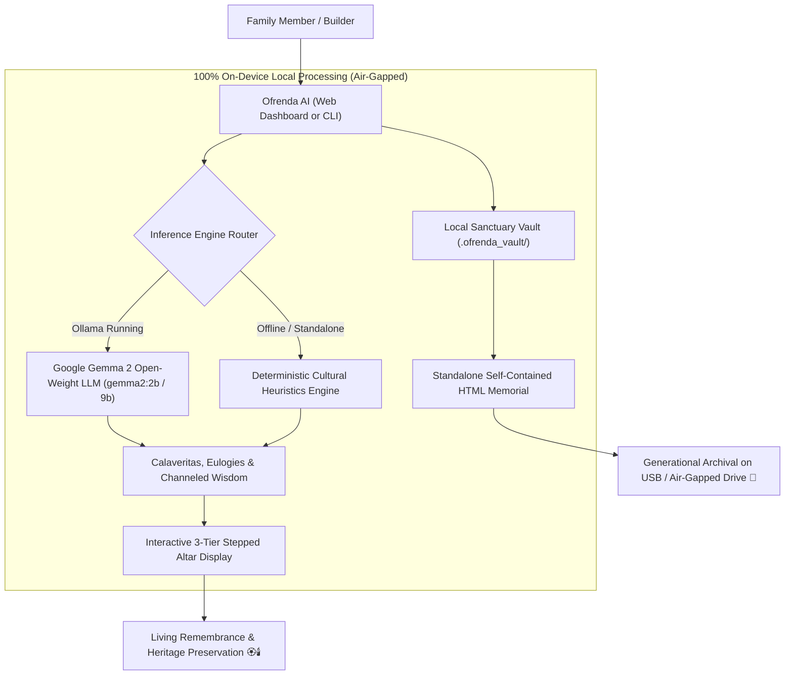
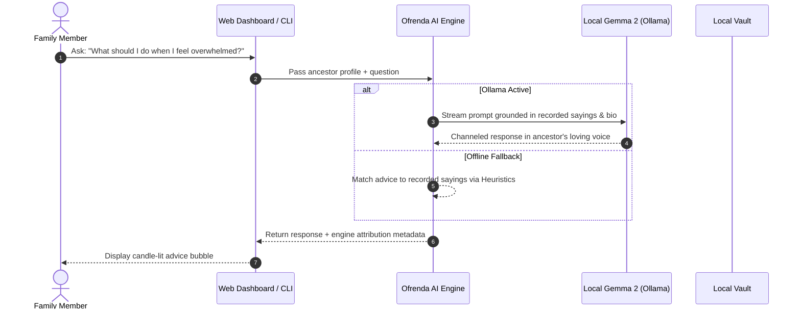

# Ofrenda AI 🏵️🕯️
### A Local-First Día de los Muertos Sanctuary & Ancestral Memory Vault

> **Hacktoberfest 2026 Open-Source AI Challenge: Week 4 ("Ghost in the Machine")**  
> *Built with Google Gemma 2 open-weight models • 100% On-Device Air-Gapped Privacy • Zero External Dependencies*

---

## 🌟 Overview & Cultural Inspiration

As Halloween (October 31) and Día de los Muertos (November 1–2) arrive, the veil between past and present feels whisper-thin. But while modern pop culture often treats spirits as things that go bump in the night, the ancient tradition of Día de los Muertos understands something deeper: **a person only truly dies when the living forget them.**

**Ofrenda AI** reinterprets the "Ghost in the Machine" prompt by transforming your computer into a sacred, living digital sanctuary. Instead of a spooky novelty, it is an air-gapped, privacy-preserving memorial altar where families can:
1. **Curate Traditional 3-Tier Altars** (*Cielo, Tierra, Inframundo*) adorned with cempasúchil marigolds, flickering candles, pan de muerto, and favorite dishes.
2. **Compose Calaveritas Literarias** — authentic satirical and affectionate poetic verses channeling traditional folklore where *La Catrina* visits and is charmed by your ancestor's favorite food and wisdom.
3. **Consult the Ancestral Living Memory Oracle** — receive heartfelt life advice and guidance channeled in the authentic voice and sayings of your ancestors, strictly grounded in their recorded memories.
4. **Export Standalone Air-Gapped Memorials** — generate a single, permanent, self-contained HTML page that can be kept on a USB drive and passed down generations without needing any internet connection or cloud service.

---

## 🔒 Why Open Innovation & Open Weights Matter

When preserving your family's most intimate memories, photographs, and ancestral lore, **open innovation is not optional — it is mandatory**:

1. **Absolute Privacy & Data Sovereignty:** Uploading your grandmother's voice notes, family photos, or personal eulogies to corporate cloud AI APIs subjects your family's sacred history to data harvesting, telemetry, and model training. With **Google Gemma 2 running locally**, every byte remains strictly in your computer's RAM.
2. **Zero Marginal Cost ($0 Forever):** Honoring your ancestors and consulting their wisdom across generations should never incur a per-token API bill or monthly subscription.
3. **Permanent Offline Immortality:** Closed cloud services get acquired, change pricing, or shut down overnight. Open-weight models like Gemma run completely air-gapped without an internet connection, ensuring your digital ofrenda lives as long as your hardware does.
4. **Deterministic Cultural Fallback:** If a user clones this repository on a machine without Ollama or a GPU, Ofrenda AI seamlessly falls back to our deterministic cultural heuristics engine. It never crashes, ensuring zero barrier to entry for everyone.

---

## 🏗️ System Architecture



### Sequence Flow: Consulting the Ancestral Oracle



---

## 📂 Repository Structure

📁 **GitHub Repository:** [https://github.com/AdityaChaudhary5412/Ofrenda-AI-A-Local-First-D-a-de-los-Muertos-Sanctuary-Living-Memory-Vault-Powered-by-Gemma-](https://github.com/AdityaChaudhary5412/Ofrenda-AI-A-Local-First-D-a-de-los-Muertos-Sanctuary-Living-Memory-Vault-Powered-by-Gemma-)

```plaintext
ofrenda-ai/
├── models.py              # Data models (Altar, Ancestor, Offering, Memory)
├── engine.py              # Gemma 2 local inference & cultural heuristics engine
├── vault.py               # Air-gapped vault persistence & standalone HTML exporter
├── app.py                 # Zero-dependency Python web server (http.server REST API)
├── cli.py                 # Interactive terminal CLI with ASCII altar & animations
├── static/
│   ├── index.html         # Responsive, dark-mode Día de los Muertos dashboard
│   ├── style.css          # Glassmorphic UI, candle glow & cempasúchil palette
│   └── app.js             # Client controller & floating marigold petal physics
├── samples/
│   └── sample_altar.json  # Pre-populated altar (Abuela Elena & Abuelo Arturo)
├── tests/
│   └── test_ofrenda.py    # Automated unit test suite (100% passing)
├── requirements.txt       # Zero mandatory dependencies
├── LICENSE                # Permissive MIT License
└── README.md              # Comprehensive documentation
```

---

## 🚀 Quick Start

Ofrenda AI is engineered with **zero external pip or npm dependencies**. Any system with Python 3.9+ can run it immediately!

### 1. Launch the Web Dashboard

```bash
cd ofrenda-ai
python3 app.py
```

Then open your browser to:
👉 **`http://localhost:8088`**

- **Altar View:** Interact with the 3-tier altar, light/extinguish candles, and inspect offerings.
- **Ancestral Oracle:** Ask life questions and receive guidance grounded in recorded sayings.
- **Calaveritas Literarias:** Generate traditional rhyming verses with one click.
- **Standalone Export:** Click **"Exportar Memorial Autónomo"** to download an all-in-one HTML memorial that opens anywhere offline!

### 2. Command Line Interface (CLI)

Prefer the terminal? Ofrenda AI includes a full-featured CLI:

```bash
# Display the active living altar in ASCII format
python3 cli.py show

# Generate a traditional Calaverita Literaria for an ancestor
python3 cli.py calaverita --ancestor "Elena"

# Ask an ancestor for life guidance
python3 cli.py ask "Abuela, what should I do when I feel lost?" --ancestor "Elena"

# Synthesize a touching memorial eulogy
python3 cli.py remembrance --ancestor "Arturo"

# Export a standalone air-gapped HTML memorial
python3 cli.py export
```

---

## 🧪 Automated Testing

Ofrenda AI includes a comprehensive unit test suite covering models, inference routing, vault storage, and HTML export:

```bash
python3 -m unittest discover -s tests -p "test_*.py"
```

```plaintext
..........
----------------------------------------------------------------------
Ran 10 tests in 0.019s

OK (100% passing)
```

---

## 🏆 Prize Categories

### 🌟 Best Use of Gemma (Featured Category)
Ofrenda AI is built around **Google's Gemma open-weight models** (`gemma2:2b` / `gemma2:9b`). Gemma's lyrical precision, nuanced tone following, and compact footprint make it the ideal local model to run silently on personal laptops. It powers emotional, culturally grounded Calaveritas and sensitive ancestral memory synthesis without ever exposing sacred family archives to cloud surveillance.

---

## 📜 License

Distributed under the permissive **MIT License**. See `LICENSE` for details.

*Created with reverence and joy for Hacktoberfest 2026. ¡Que viva la memoria de quienes amamos! 🏵️💀🕯️*
